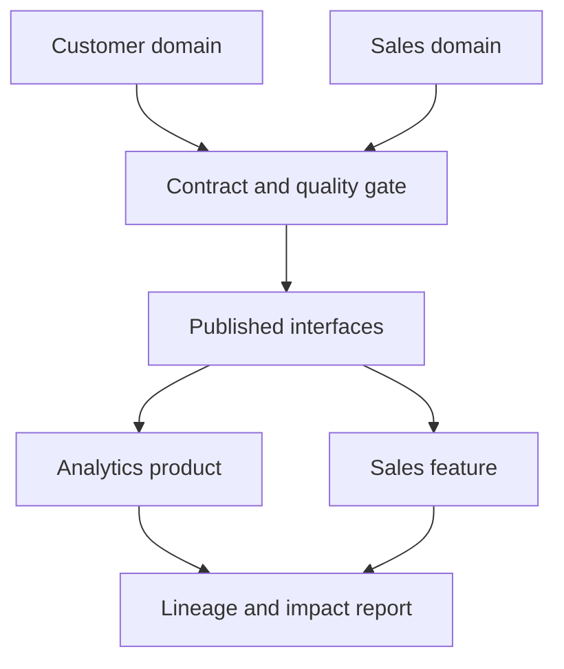

# Domain-Driven Data & AI Platform — Research Companion

A **small, executable educational companion** to:

> Sharma, A. (2026). *Domain-Driven Data and AI Platforms: Governing Analytics and Machine Learning Pipelines at Scale.* **IET Software**, 2026(1), 4364820. https://doi.org/10.1049/sfw2/4364820

The example provides **four synthetic domain-owned data products**, contract checks, a publication gate, permission-list simulation, and product-level lineage/impact analysis.

**Important:** this is a subsequently constructed teaching reference, **not the production implementation or empirical evaluation from the paper**. It uses synthetic fixtures, does not contain employer assets, and **does not claim enterprise-ready security or measured performance gains**.

## Run locally (Python 3.10+, no external dependencies)

From the repository root:

```bash
PYTHONPATH=src python -m domain_companion
PYTHONPATH=src python -m unittest discover -s tests -v
```

Windows PowerShell:

```powershell
$env:PYTHONPATH="src"
python -m domain_companion
python -m unittest discover -s tests -v
```

The run writes `run/published/*.json` and `run/run_report.json`. The timestamp is **pinned to 2026-11-01T12:00:00Z** for reproducibility; it does not represent a live freshness system.

## Reusable components

| Research concept | Reference implementation |
|---|---|
| Explicit domain ownership | Only the declared producing domain may publish |
| Contract validation | Required fields, types, uniqueness, numeric minima and freshness |
| Governed consumption | Allowlist checks for cross-domain reads (simulation only) |
| Publication gate | Rejected data cannot replace the previously validated output |
| Product lineage | Published dependency graph and transitive impact |
| Reproducibility | Synthetic input fixtures, standard-library code, and tests |

## Architecture



## Limitations

The domain allowlist is *not* real authentication or authorization. This demonstration omits distributed transactions, full schema registry/version migrations, real streaming infrastructure, data classification, managed feature stores, real ML training, and an experimental comparison with alternative architectures. The 30-day feature name describes the bounded input fixture, not a general time-window engine.

## Cite the research

If the concepts inform your work, please consult and cite the peer-reviewed article **when relevant**: https://doi.org/10.1049/sfw2/4364820. GitHub citation metadata is available in [CITATION.cff](CITATION.cff).

## Next steps

Review the demo and tests; share reproducible bug reports through GitHub Issues. A future tagged release may be archived with Zenodo once its DOI exists.

Code licensed under MIT; publisher's article has its own terms. No affiliation or endorsement by the publisher or employer is implied.
