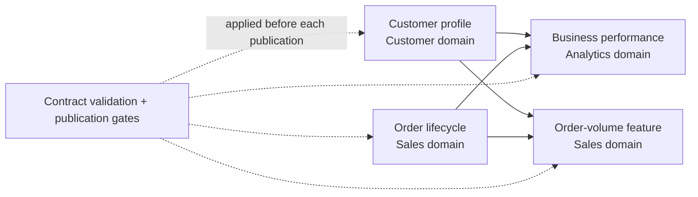

# Beyond the Data Mesh Diagram: Making Domain Data Products Governable with Contracts and Lineage

*By Akshay Sharma | Technical implementation guide | November 2026*

It is easy to draw a data-mesh architecture. Customer data belongs to the customer domain, order data belongs to the sales domain, and analytics teams consume well-defined data products instead of querying every operational table directly. The architecture starts to become difficult when a contract changes, an upstream dataset is stale, or a downstream feature silently inherits an invalid value. At that point, the operational question is not whether teams have been assigned domain ownership; it is whether the platform can tell the difference between data that is ready to publish and data that should be stopped.

Zhamak Dehghani's [data mesh principles](https://martinfowler.com/articles/data-mesh-principles.html) established the importance of domain ownership, data as a product, self-service platforms, and federated computational governance. These principles are a foundation, not a guarantee that individual implementations enforce contract boundaries. My open-access paper, [*Domain-Driven Data and AI Platforms: Governing Analytics and Machine Learning Pipelines at Scale*](https://doi.org/10.1049/sfw2/4364820), develops a domain-driven system model that treats data products, pipelines, features, and models as artifacts with explicit owners and interfaces. This article focuses on a narrower, testable question: **what would it take to make a small part of that governance model executable?**

To explore the question, I released an [open-source, synthetic research companion](https://github.com/akshaysharma1088/domain-driven-ai-research-companion) that exercises contracts, publication checks, declared cross-domain dependencies, and product-level impact analysis. The code uses Python's standard library and local JSON files, intentionally avoiding a dependency on any particular warehouse, orchestration service, or data catalog. That makes it convenient for developers and researchers to inspect, run, change, and challenge the rules. It is an educational demonstration, not a reproduction of the paper's enterprise evaluation or a production authorization system.

## The boundary that makes a domain product meaningful

Consider two producing domains: **Customer** publishes customer profiles and **Sales** publishes order lifecycle records. An **Analytics** domain consumes both to create a business performance product. Sales also produces a simple order-volume feature by consuming its own order records alongside the published customer product. Rather than allow every consumer to read unvalidated internal records, each producer has a declared contract and an explicit publication step.

The four data products in the example are:

| Product | Owning domain | Inputs | Intended output |
|---|---|---|---|
| `customer.customer_profile` | Customer | Synthetic customer fixture | Customer identifiers, segments, update times |
| `sales.order_lifecycle` | Sales | Synthetic order fixture | Order identifiers, amounts, states, event times |
| `analytics.business_performance` | Analytics | Published customer and order products | Completed-order count and revenue per customer |
| `sales.order_volume_feature` | Sales | Published customer and order products | Completed-order count per customer for the bounded fixture |

This is the dependency structure implemented by the project:



The important boundary is not the diagram itself. Each downstream product requests its inputs through the catalog's **published** interface, and the catalog checks the consumer domain against a declared allowlist. This models an architectural intention: consumers should depend on stable interfaces rather than the producing domain's private implementation. In the present code, a caller supplies its domain as a string, so this is **an allowlist simulation**, not authenticated access control. A production implementation would have to bind identity to a real enforcement mechanism.

## Data contracts need more than a schema

A schema can say that an amount is numeric and a timestamp is a string. A usable data-product contract needs to carry more context: who owns the data, who may consume it, which fields must be present, how freshness is defined, and which records must be unique. The project's contracts declare those properties in JSON.

For example, the order-lifecycle contract declares `order_id` as a unique key, sets a non-negative minimum for `amount`, and uses `event_time` for a bounded freshness check. One part looks like this:

```json
{
  "product_id": "sales.order_lifecycle",
  "domain": "sales",
  "quality": {
    "min_rows": 1,
    "unique_key": ["order_id"],
    "freshness_field": "event_time",
    "max_age_days": 14,
    "minimums": { "amount": 0 }
  }
}
```

Those assertions give a concrete meaning to *publishable* data. For this example, a data product should not be published if it contains a duplicate order identifier, a missing required amount, a negative amount, or an event timestamp outside its accepted freshness window. The contract is versioned, and a separate compatibility helper flags certain breaking changes such as removing an existing field or changing its declared type. The helper is intentionally limited: production compatibility review would also need to consider nullability, accepted value ranges, business semantics, and downstream consumers.

The implementation validates the entire candidate batch before writing the published file. Its core publication rule is conceptually straightforward:

```python
errors = validate(contract, proposed_rows, as_of)
if errors:
    raise GovernanceError("; ".join(errors))
# Only validated rows reach the published interface.
```

In the local reference, validated content is written to a temporary file and then moved into place. A rejected batch therefore does not replace the previously published JSON file. This is useful behavior to demonstrate, but it must not be mistaken for a distributed transaction, a streaming checkpoint, or guaranteed atomicity across multiple products.

## A reproducible example rather than a performance claim

The repository includes small synthetic fixtures: three customer records and four order records. Two of the orders for customer `C101` are completed, for a total of **110.50** in the fixture's currency-neutral numeric amounts; a third order for that customer is pending and excluded. Customer `C102` has one completed order worth **125.00**, while `C103` has no orders in the fixture.

These counts are **deterministic examples derived from the included sample rows**, not enterprise-scale empirical outcomes. A successful run publishes the two source products, computes the analytics product, computes the illustrative sales feature, and writes a report with the product dependencies and impacted downstream products.

Run the project from the repository root using Python 3.10 or later:

```bash
PYTHONPATH=src python -m domain_companion
PYTHONPATH=src python -m unittest discover -s tests -v
```

For Windows PowerShell:

```powershell
$env:PYTHONPATH="src"
python -m domain_companion
python -m unittest discover -s tests -v
```

The generated `run/run_report.json` describes which products were published and lists their dependency edges. The input timestamp is pinned to **2026-11-01T12:00:00Z** so that a reader rerunning the example later does not get a different freshness result merely because the clock has advanced. There is no live ingestion or continuously updating service in this example.

The unit tests check several failure scenarios as well as the successful flow:

| Failure or behavior | Expected behavior in the example |
|---|---|
| Missing required amount | Validation rejects the candidate batch |
| Negative order amount | Contract minimum rejects the candidate batch |
| Duplicate order identifier | Uniqueness check rejects the candidate batch |
| Stale or future event timestamp | Freshness check rejects the candidate batch |
| Wrong declared producing domain | Publication is rejected |
| Unlisted consuming domain | Published-product access is denied in the simulation |
| Invalid replacement batch | Previously published file remains unchanged |
| Valid synthetic flow | Four products publish; dependencies and impact are recorded |

These are assertions exercised by the project and its automated tests, not measurements of real-world reliability improvements. The distinction matters. The existence of a failure-gate test shows that a particular failure case has been considered; it does not establish that a production data platform has become safer under concurrent writes, identity compromise, partial infrastructure failures, or adversarial data.

## Lineage should answer a question, not just draw arrows

Lineage is often presented as a graph of jobs and tables. That graph is useful for operations, but a platform consumer frequently needs a more specific answer: *if the Customer Profile contract changes, which published products could be affected?* The sample catalog represents dependencies as directed edges between declared data products and calculates the transitive downstream set.

Within the sample graph, a change to `customer.customer_profile` can affect both `analytics.business_performance` and `sales.order_volume_feature`. This is **product-level declared lineage**, not field-level provenance. It cannot prove which source record generated an individual downstream value or trace a model prediction back to its training examples. Nevertheless, the product-level graph provides a useful hook for design-time impact checks, change review, test selection, and eventual notification workflows.

A natural extension would be to combine that declared dependency graph with runtime lineage collected from actual executions. The two kinds of lineage answer different questions: a declared graph captures intended interfaces, while observed lineage can reveal unexpected coupling or bypassed contracts. Comparing them is a testable research problem rather than an assumption that the two always agree.

## Where this fits in an enterprise data stack

The sample is intentionally small enough to run without Snowflake, Spark, dbt, Airflow, or a model serving platform. That portability helps expose the responsibilities before assigning them to any specific technology. In a real deployment, however, those responsibilities would be distributed across several services.

The contract could live alongside a data product's version-controlled definition, with validation executed as part of a CI/CD or data-quality workflow. A catalog would need durable metadata, identity-aware access policies, audit logs, ownership and lifecycle management. Published data might live behind versioned tables, views, APIs, or events, while lineage could integrate orchestration events and query-level provenance. The validation boundary would also need transactional publication semantics appropriate to the storage engine.

ML features add a further challenge. It is not enough that a feature has a declared owner and type; its definition should specify time windows, leakage constraints, training/serving consistency, and when its meaning can change. The companion's `completed_order_count_30d` name is **only illustrative**: in this fixture, it counts completed orders present in the bounded input, not a genuine rolling 30-day computation. Making that window real—and testing it against late-arriving events—would be a meaningful next enhancement.

## What would turn this example into publishable systems evidence?

A minimal reference implementation is valuable when it makes assumptions explicit, but it should not be mistaken for a benchmark. A stronger empirical study would compare at least two equally capable architectures under a controlled set of failures, with reproducible datasets, a declared workload, and prespecified evaluation metrics.

I would test four dimensions:

1. **Containment:** When invalid, stale, or schema-incompatible records appear, what fraction reach a downstream published product?
2. **Change impact:** How accurately and quickly can the system identify downstream consumers affected by schema and semantic changes?
3. **Recovery:** After a failure, how long does it take to restore a correct published state without introducing duplicates or inconsistent versions?
4. **Operational cost:** What latency, infrastructure overhead, and engineer effort does enforcing contracts and lineage introduce compared with an equally capable baseline?

The experiment should also report where the governance approach performs poorly: overly strict contracts can block legitimate changes, lineage can be incomplete, and validation can become a bottleneck. A rigorous baseline, failure-injection protocol, shared data, and statistical analysis would allow others to evaluate these trade-offs rather than accepting an architectural claim on faith.

## A small but concrete starting point

Domain ownership becomes operationally useful when a product has an identified publisher, a documented interface, a clear validity condition, and a way to understand what depends on it. The [research companion repository](https://github.com/akshaysharma1088/domain-driven-ai-research-companion) turns those ideas into inspectable code and tests, while making its boundaries explicit. Its purpose is to enable discussion and extension—not to claim that a handful of JSON files replicates an enterprise platform.

For the broader domain-driven system model and the governance-by-construction argument, see the [peer-reviewed IET Software article](https://doi.org/10.1049/sfw2/4364820). If you reuse the companion software, the archived **v0.1.0** snapshot is identified by [Zenodo DOI 10.5281/zenodo.23875963](https://doi.org/10.5281/zenodo.23875963). Cite the contribution you actually use; readers can examine both artifacts independently.

---

### References and artifacts

- Dehghani, Z. (2020). [*Data Mesh Principles and Logical Architecture*](https://martinfowler.com/articles/data-mesh-principles.html).
- Sharma, A. (2026). [*Domain-Driven Data and AI Platforms: Governing Analytics and Machine Learning Pipelines at Scale*](https://doi.org/10.1049/sfw2/4364820). *IET Software*, 2026(1), 4364820.
- Sharma, A. (2026). [*Domain-Driven Data and AI Platforms — Research Companion*, v0.1.0](https://doi.org/10.5281/zenodo.23875963). Zenodo software archive.
- [Reference implementation, contracts, synthetic fixtures, and tests](https://github.com/akshaysharma1088/domain-driven-ai-research-companion).
